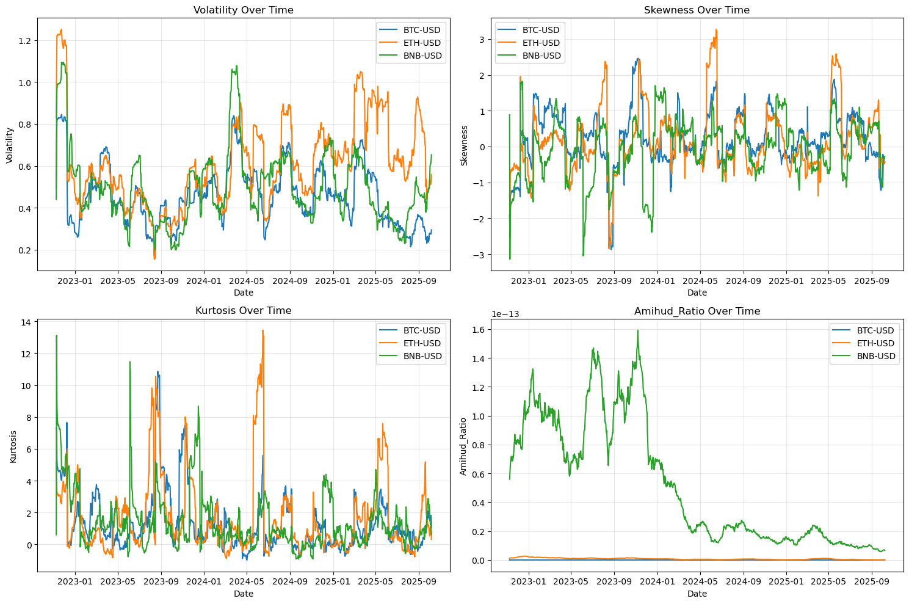
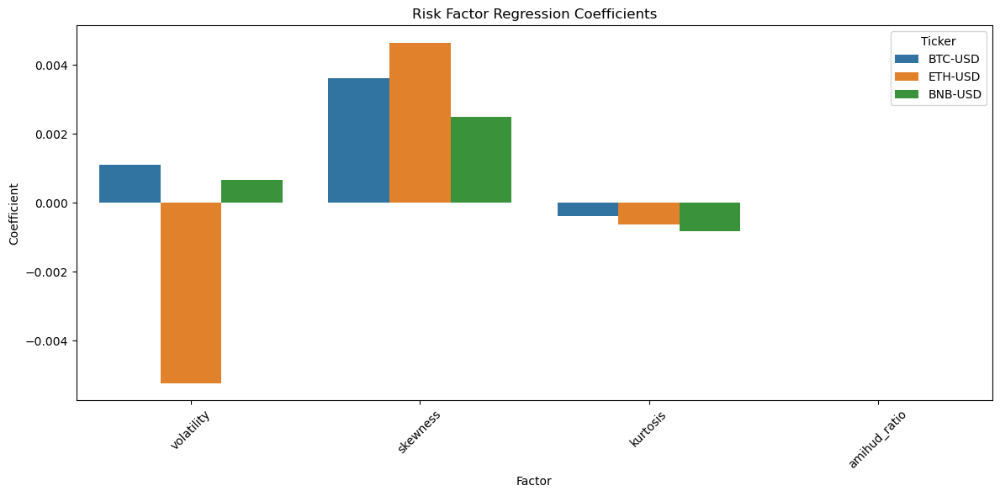
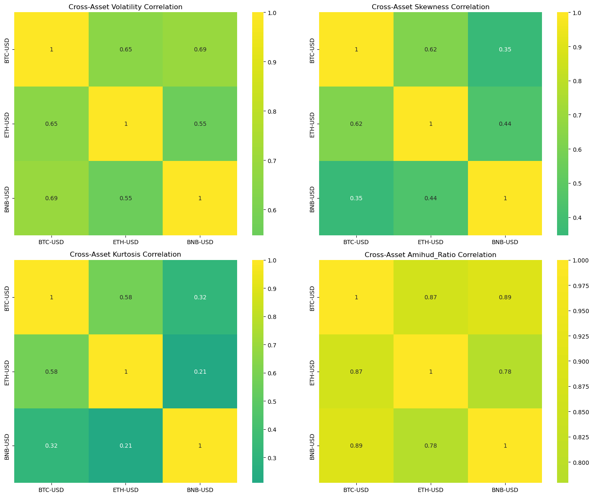
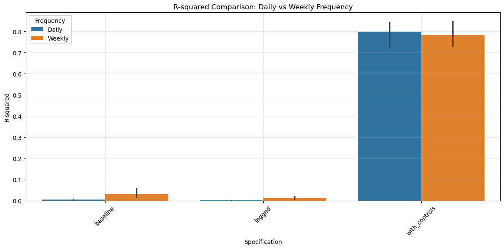

# Crypto Risk Factor Analysis (BTC, ETH, BNB)

Tests whether rolling **volatility, skewness, kurtosis and Amihud illiquidity** explain daily and weekly returns of BTC, ETH and BNB over 3 years, then checks how robust those results are using lagged factors, market and momentum controls, and **Newey-West** standard errors. Built during my Data Analyst internship at **Mechcraft-tech** (Oct 2025).



## v1 — Baseline (`v1_baseline/`)

- 3 years of daily prices and volumes from `yfinance`; log returns
- 30-day rolling annualized volatility, skewness, kurtosis and the Amihud illiquidity ratio
- Correlation matrices, both within each coin and across the three coins
- OLS regression of daily returns on the four factors, with t-statistics and p-values

**Findings**

- **Skewness was the only factor significant for all three coins:**

  | Coin | Coefficient | p-value |
  |---|---|---|
  | BTC | 0.0036 | 0.0003 |
  | ETH | 0.0047 | 0.0006 |
  | BNB | 0.0025 | 0.029 |

  This fits the "lottery preference" idea from behavioral finance.
- Volatility, kurtosis and illiquidity were not significant.
- R² was only about 1%. Daily crypto returns are mostly noise and event-driven.
- Across coins, volatility was strongly correlated (0.55–0.69). Kurtosis and skewness were less correlated, so tail risk is partly asset-specific.




## v2 — Robustness checks (`v2_robustness/`)

Three model specifications at **daily and weekly** frequency, all with **HAC (Newey-West) standard errors**:

| Specification | Factors | Mean R² (daily) | Mean R² (weekly) |
|---|---|---|---|
| baseline | Same-period factors | 0.6% | 3.2% |
| lagged | Factors lagged one period | 0.1% | 1.4% |
| with_controls | Lagged factors + market return + momentum | 79.8% | 78.2% |

**Findings**

- The skewness effect weakens once standard errors are robust:
  - Daily: still significant for BTC (p = 0.011) and ETH (p = 0.014), but no longer for BNB (p = 0.13)
  - Weekly: significant only for BTC (p = 0.022)
  - It disappears after adding controls.
- **Lagged factors have almost no predictive power.** The four risk metrics describe risk, but they do not forecast returns.
- The jump in R² with controls comes from the market-return term (t-statistic ≈ 17–20). One caveat: the market proxy is the equal-weighted average of the same three coins, so it includes each coin's own return. Part of that fit is mechanical.



## Files

| Path | Description |
|---|---|
| `v1_baseline/risk_factors_v1.ipynb` / `.py` | Factor calculation, correlations, OLS and charts |
| `v2_robustness/risk_factors_v2.ipynb` / `.py` | Daily vs. weekly results, lagged factors, controls, Newey-West |
| `report.pdf` | Written report for v1: methodology, findings and risk-mitigation recommendations |
| `images/` | Charts used in this README |

```bash
pip install -r requirements.txt
jupyter notebook v1_baseline/risk_factors_v1.ipynb
```

Data is pulled live from Yahoo Finance, so a new run covers a newer 3-year window and gives slightly different numbers.

## Next steps

- Use an external market proxy, such as a total-crypto-market index, to remove the mechanical overlap
- Run rolling-window and out-of-sample tests to check that the coefficients are stable
- Add PCA or factor analysis across a wider set of coins
